# Nimbus — cloud mascot + habit worlds

A soft-vinyl cloud mascot built procedurally (SDF shape → Blender → three.js), with a face, moods and
animations, living in a habit app: every planet around Nimbus is one area of your life, you give each one your
own small daily tasks, and the planets grow as you keep them.

Live: https://cloud-mascot.vercel.app (deploys `site/`; the app is now the main page, the old room demo is
`room.html`)

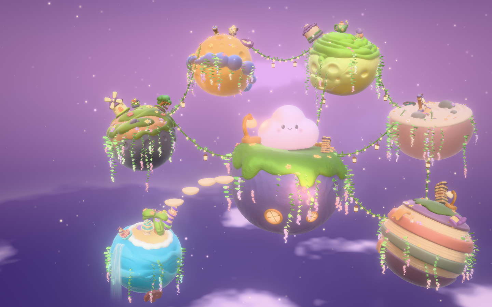

## The app (`site/index.html`)

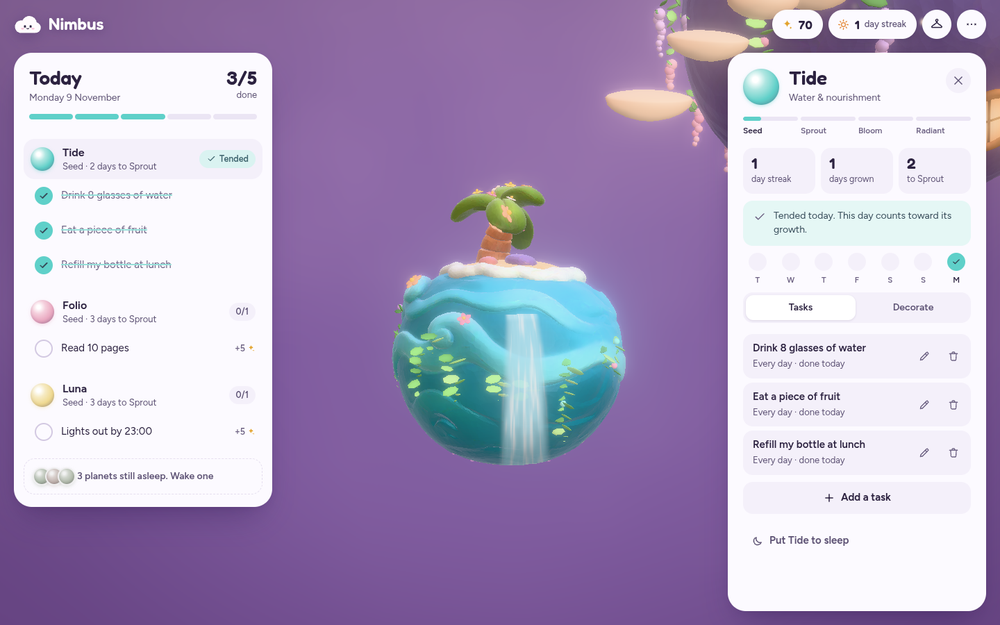

| First run | Wardrobe | Next morning | Phone |
|---|---|---|---|
| 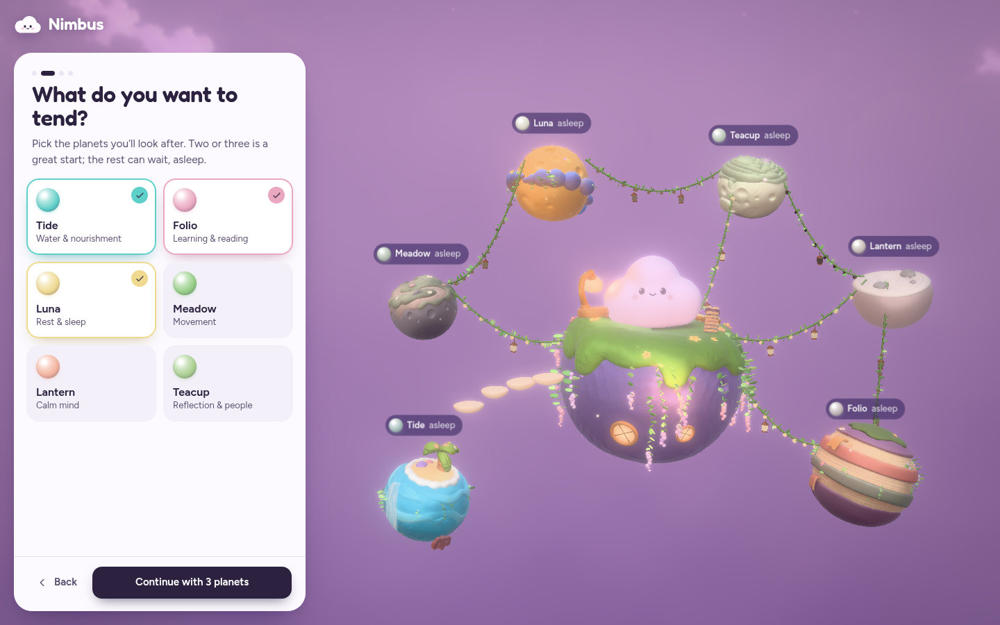 | 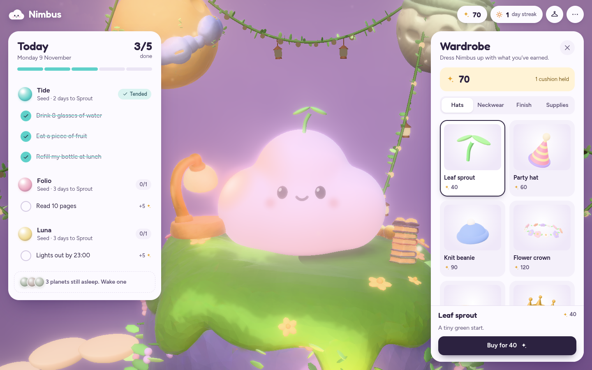 | 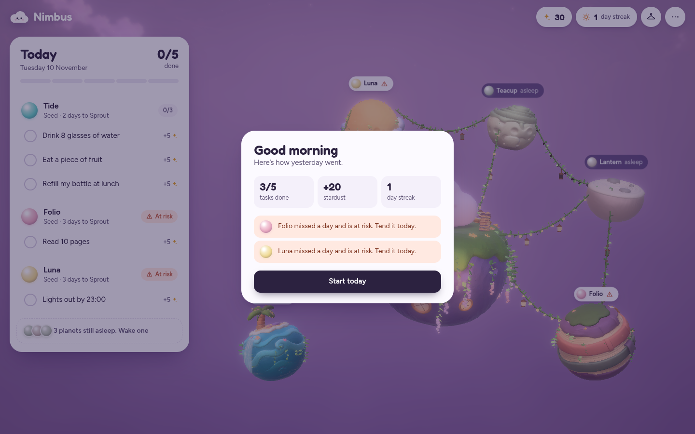 | 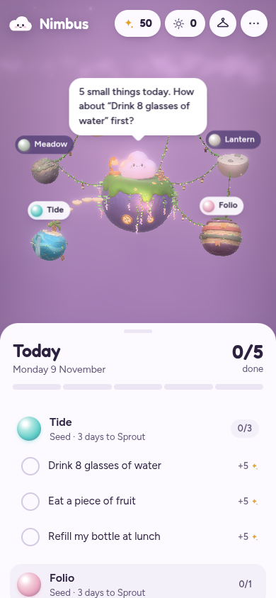 |

**How it plays** (all rules in `site/js/rules.js`, pure functions, covered by `tests/rules.test.mjs`):

- **Planets are areas of life:** Tide (water & nourishment), Folio (learning), Luna (rest & sleep), Meadow
  (movement), Lantern (calm mind), Teacup (reflection & people). You wake the ones you want and give each up to
  5 of your own tasks, every day or on chosen weekdays. The others sleep: faded, small, nothing to lose.
- **Stardust:** +5 per task, +5 when all of a planet's tasks are done (the planet is *tended*), +10 when the whole
  day is done (*clear skies*), +25 the first time a planet reaches a stage. Un-ticking refunds exactly.
- **Growth:** each tended day counts. Seed → Sprout (3) → Bloom (7) → Radiant (14); each stage makes the planet
  bigger and lusher and unlocks that planet's decor, which you place on it by tapping its surface.
- **Never miss twice:** one missed day only puts a planet *at risk*. A second miss in a row resets its streak,
  and each further missed day wilts it by a growth day (it can shrink back a stage).
- **Cloud cushions:** take the hit for a second miss automatically. Start with one, earn one per 7-day planet
  streak, or buy them; hold up to three.
- **Days end at 03:00**, so late-night tasks count for the evening they belong to. Days with nothing scheduled are
  rest days for that planet.
- **Wardrobe:** spend stardust on hats, neckwear and vinyl finishes for Nimbus (`site/js/wardrobe.js`, all built
  from three.js primitives and fitted to the body by raycasting, so no new model files). A few items need a planet
  at Bloom or Radiant first, so the shop also shows what's ahead.

**The experience:** a splash with real loading progress (the world loads in parallel and compiles its shaders
before it's revealed, so the UI never appears over an empty scene); a four-step first run that wakes the planets
you pick live in 3D and flies to each one while you choose its tasks (or "Use examples"); a Today list grouped by
planet with a per-task progress strip; stars that fly from a ticked task into the stardust counter; Nimbus
reacting (hops, wiggles, spins, a worried face when a planet is at risk, sleepy after 23:00) and talking in a
speech bubble with context-aware lines; floating planet labels with today's progress; a planet sheet with stage
track, streak, 7-day history, task editing and decor; a "Good morning" recap when a new day starts. The camera
frames the free space around whichever panels are open (`setViewOffset`), so nothing hides behind the UI. On phones
the panels become bottom sheets. The menu has "Skip to tomorrow" to try the day loop without waiting.

Code: `js/app.js` (UI and flow), `js/rules.js` (game rules), `js/world.js` (the 3D world, no UI),
`js/wardrobe.js`, `js/icons.js`, `app.css`. Type: Figtree for the interface, Fredoka for Nimbus's voice, both
self-hosted in `assets/fonts/`.

## The planet world

`site/js/world.js`. Nimbus lives on its home planet; the six habit planets float close by, strung together with
vine garlands. A planet's stage sets its size, its growth sets how lush it is (vines, wisteria, flowers), and a
sleeping planet is small and faded. Earlier screenshots of the world from the pre-app demo:

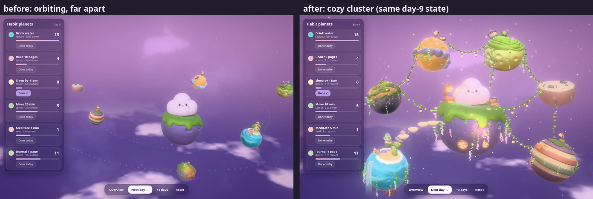

- Planet + item models: generated with Pixal3D (image → 3D) from `assets_src/planets/*.png`, cleaned and
  oriented (`scripts/pixal3d_*.py`, `scripts/model_orient.py`), shipped as meshopt GLBs in `site/assets/planets/`.
- Cozy layer (`site/js/cozy.js`), all procedural three.js — geometry, shaders and lights, no extra assets:
  vines and flowers placed on each model's real surface that grow with the streak in the vertex shader, vine
  garlands with glowing bulbs and lanterns, glowing round windows, a shader waterfall, stepping stones, fireflies.
- Look (`site/js/spacelook.js`): painted pastel sky, clay finish for the generated models, bloom + vignette.
- Cloudscape (`site/js/cloudscape.js`): generated lavender-and-peach sky artwork behind the live planet scene,
  with responsive cover cropping, slow drift, reduced-motion support, and a procedural sky fallback.
  The optimized artwork ships locally as `site/assets/cloudscape-v1.jpg` (167 KB).
- Thick fog (`site/js/thick-fog.js`): a continuous world-space volume integrated up to each visible surface,
  filling the gaps and partially obscuring the islands from every viewing direction, without a bounding box.
  A small clearing keeps Nimbus readable, and a distance fade keeps nearby surfaces clear when decorating.
  Compositing retains full fog in empty space and 10% of its strength over solid surfaces for clearer planets.
  The fog runs at half resolution with depth-aware upsampling, gentle density drift, and reduced-motion support.

All 27 models (`site/models.html` shows them next to their reference images):

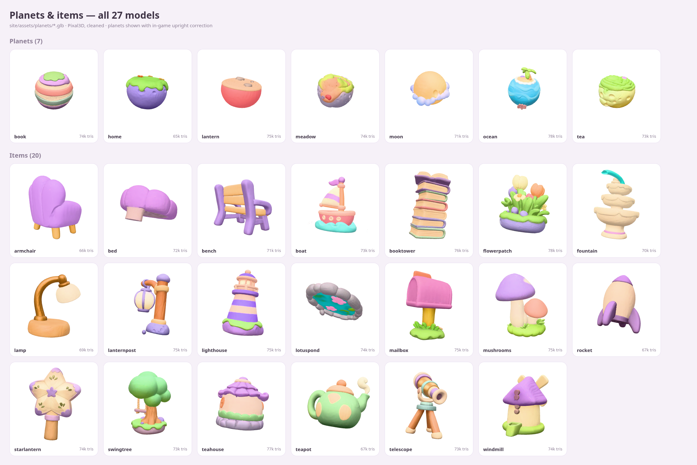

## The mascot

| Hero | Expressions |
|---|---|
| 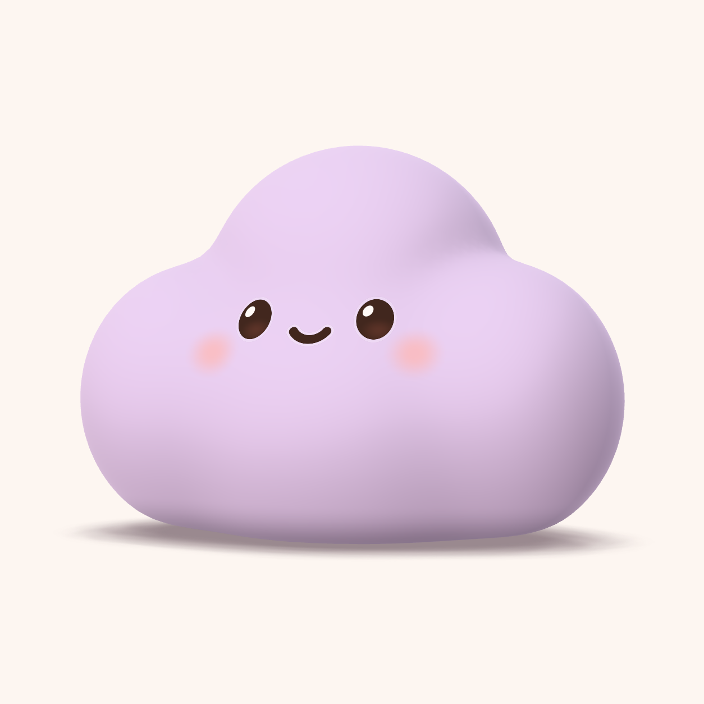 | 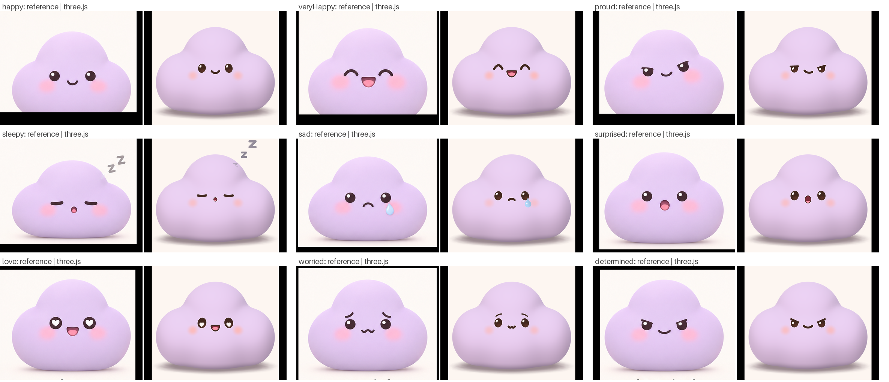 |

- **Shape:** soft lobes as an analytic SDF fitted to reference silhouettes (IoU ≥ 0.96), meshed and retopologised
  in headless Blender, mirror-exact, normals from the SDF gradient.
- **Material:** MeshPhysicalMaterial + shader additions (edge glow, wrap lighting, contact darkening); lighting
  fitted to the reference colours (`site/assets/look.json`).
- **Face:** per-pixel 2D SDF decals (eyes, lids, brows, mouth, blush, tears, hearts), nine blendable expressions.
- **Animation:** morph-target shape keys + volume-preserving squash/stretch + spring jiggle; moods and clips.

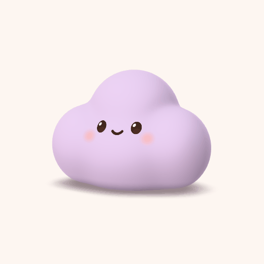 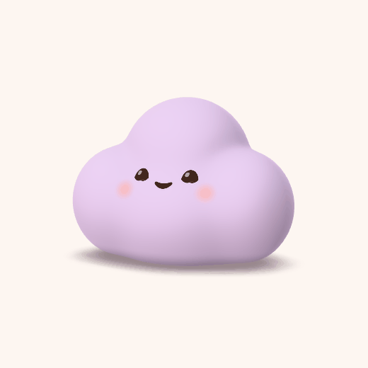 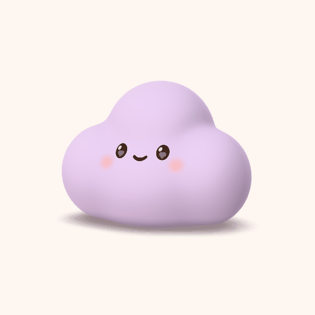

## The room (`site/room.html`)

A procedural diorama where checking habits sends sun-drops to Nimbus, streaks unlock decor, missed days bring rain.

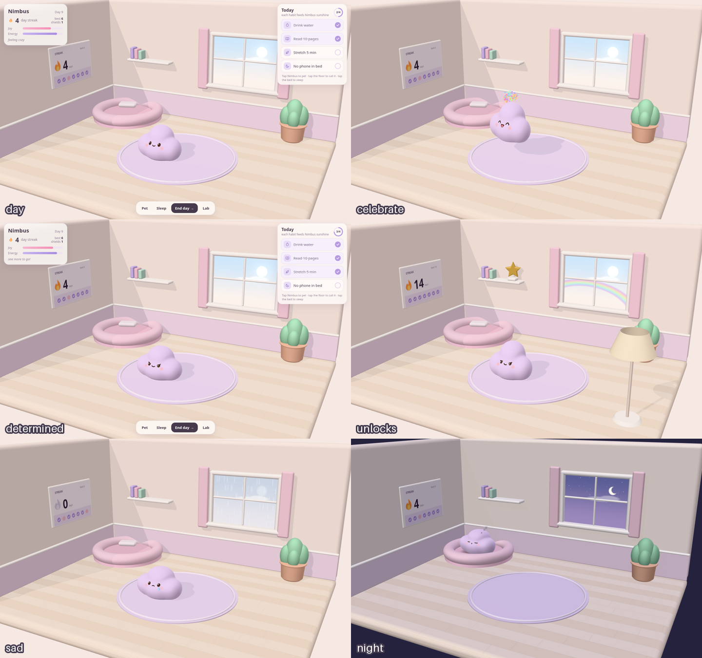

## Run it

```sh
python3 -m http.server -d site 8000
# http://localhost:8000              the app (add ?fresh for a throwaway in-memory run)
# http://localhost:8000/room.html    the room demo
# http://localhost:8000/studio.html  mascot studio (every mood, clip and face)
# http://localhost:8000/models.html  planet/item model gallery

npm test                              # game rules
npm run flow                          # drive the app headless and screenshot every step -> renders/app/
```

`scripts/flow.mjs` plays the whole app like a person (first run, ticking tasks, planet sheet, decor, wardrobe,
skipping to the next day) at desktop and phone sizes and fails on any page error. The room and studio keep their
deterministic test mode (`?shot=…`, `scripts/shoot.mjs`).

`./build.sh` rebuilds the mascot from `refs/` (needs Blender and a Python venv; see the flags at the top of the
script). Full pipeline notes and decisions: [`HANDOFF.md`](HANDOFF.md).

## Layout

```
refs/            reference images (source of truth for the mascot)
scripts/         shape fit, Blender, bakes, look tuning, screenshots, Pixal3D asset pipeline
model/           cloud.blend + fitted lobes
site/            the static site (three.js 0.170 vendored in site/vendor/)
  js/            app, rules, world, wardrobe, icons, mascot, face, anim, fx, spacelook, cozy, room, game
  assets/        cloud.glb, look, face layout, planets/*.glb
assets_src/      source images for the generated planet + item models
renders/         check renders and screenshots (the images above)
tests/           node --test unit tests for the game rules
```
