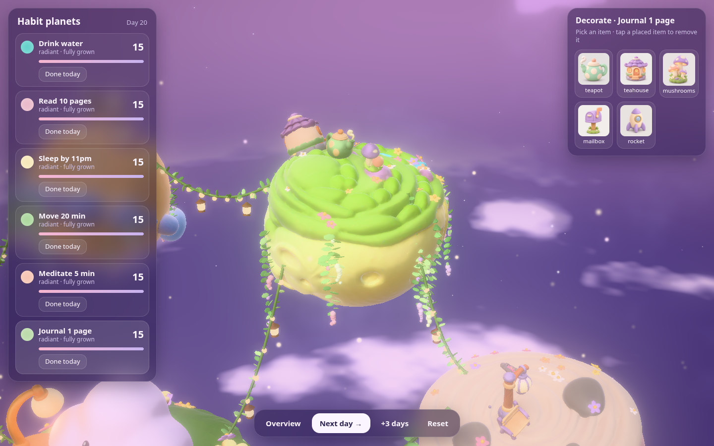
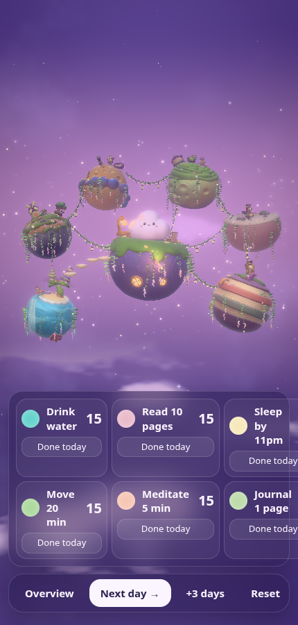

# Nimbus — cloud mascot + habit worlds

A soft-vinyl cloud mascot built procedurally (SDF shape → Blender → three.js), with a face, moods and
animations, and two habit-tracking demos around it: a cozy room and a cluster of habit planets.

Live (room demo): https://cloud-mascot.vercel.app


## Habit planets (`site/planets.html`)

Nimbus lives on its home planet; every habit gets its own planet floating close by, strung together with vine
garlands. Keep a habit and its planet grows (seed → sprout → bloom → radiant), gets lusher (vines, wisteria,
flowers) and unlocks themed items you can place on it. Miss a day and it shrinks back.


| Decorating a planet | Mobile |
|---|---|
|  |  |

- Planet + item models: generated with Pixal3D (image → 3D) from `assets_src/planets/*.png`, cleaned and
  oriented (`scripts/pixal3d_*.py`, `scripts/model_orient.py`), shipped as meshopt GLBs in `site/assets/planets/`.
- Cozy layer (`site/js/cozy.js`), all procedural three.js — geometry, shaders and lights, no extra assets:
  vines and flowers placed on each model's real surface that grow with the streak in the vertex shader, vine
  garlands with glowing bulbs and lanterns, glowing round windows, a shader waterfall, stepping stones, fireflies.
- Look (`site/js/spacelook.js`): painted pastel sky, clay finish for the generated models, bloom + vignette.

All 27 models (`site/models.html` shows them next to their reference images):


## The mascot

| Hero | Expressions |
|---|---|
|  |  |

- **Shape:** soft lobes as an analytic SDF fitted to reference silhouettes (IoU ≥ 0.96), meshed and retopologised
  in headless Blender, mirror-exact, normals from the SDF gradient.
- **Material:** MeshPhysicalMaterial + shader additions (edge glow, wrap lighting, contact darkening); lighting
  fitted to the reference colours (`site/assets/look.json`).
- **Face:** per-pixel 2D SDF decals (eyes, lids, brows, mouth, blush, tears, hearts), nine blendable expressions.
- **Animation:** morph-target shape keys + volume-preserving squash/stretch + spring jiggle; moods and clips.

  

## The room (`site/index.html`)

A procedural diorama where checking habits sends sun-drops to Nimbus, streaks unlock decor, missed days bring rain.


## Run it

```sh
python3 -m http.server -d site 8000
# http://localhost:8000              the room
# http://localhost:8000/planets.html habit planets
# http://localhost:8000/studio.html  mascot studio (every mood, clip and face)
# http://localhost:8000/models.html  planet/item model gallery
```

Every page has a deterministic test mode (`?shot=…`) used for screenshots:

```sh
SHOT_W=1440 SHOT_H=900 node scripts/shoot.mjs renders/cozy "planets.html:overview&scene=grown"
```

`./build.sh` rebuilds the mascot from `refs/` (needs Blender and a Python venv; see the flags at the top of the
script). Full pipeline notes and decisions: [`HANDOFF.md`](HANDOFF.md).

## Layout

```
refs/            reference images (source of truth for the mascot)
scripts/         shape fit, Blender, bakes, look tuning, screenshots, Pixal3D asset pipeline
model/           cloud.blend + fitted lobes
site/            the static site (three.js 0.170 vendored in site/vendor/)
  js/            mascot, face, anim, fx, room, game, planets, spacelook, cozy
  assets/        cloud.glb, look, face layout, planets/*.glb
assets_src/      source images for the generated planet + item models
renders/         check renders and screenshots (the images above)
```
